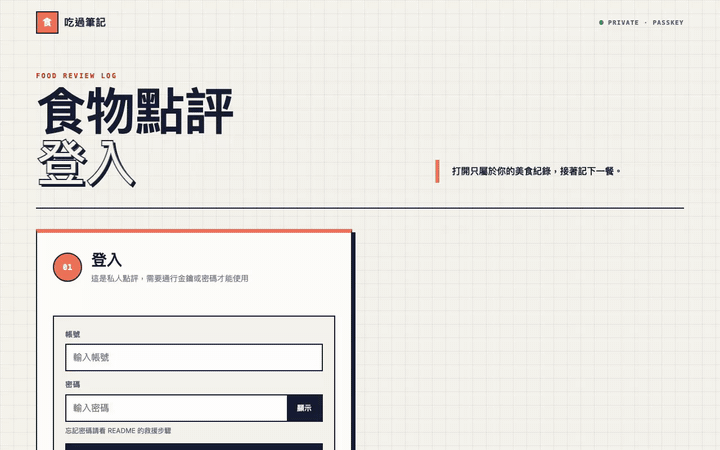
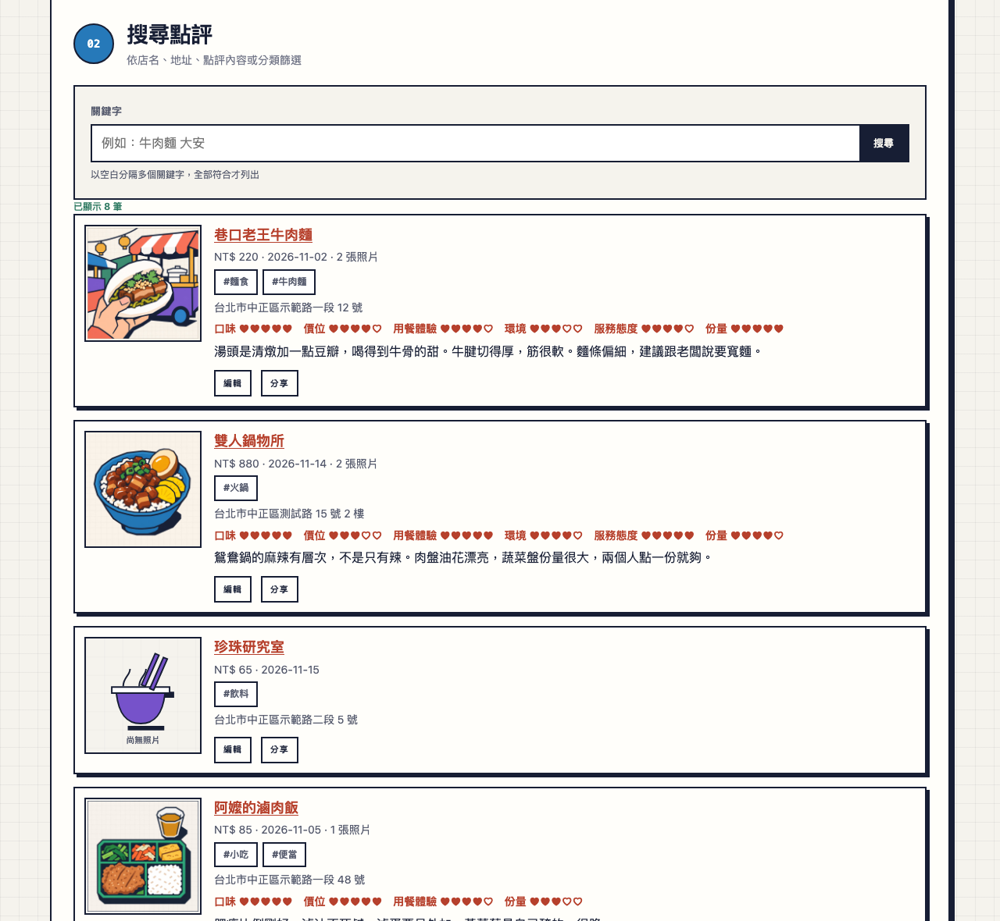
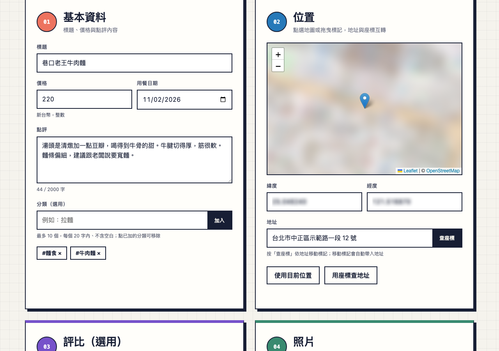
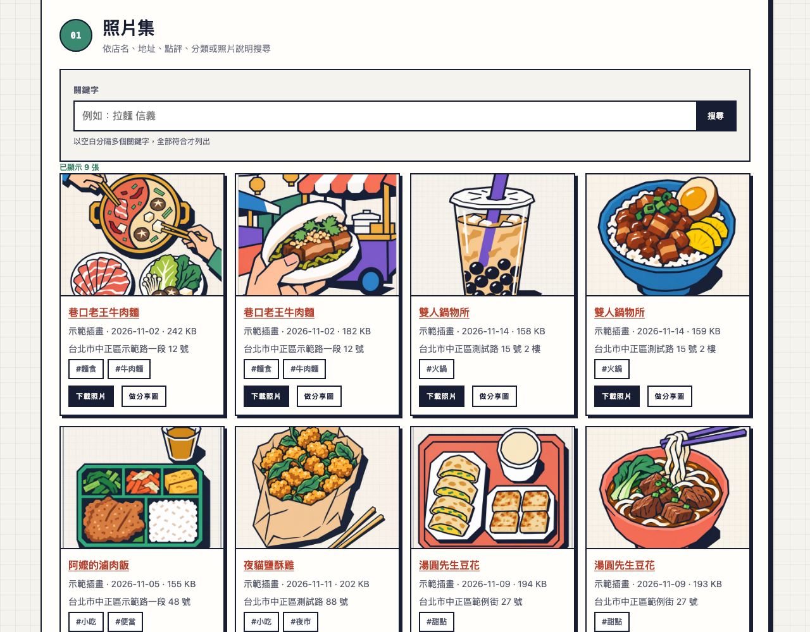
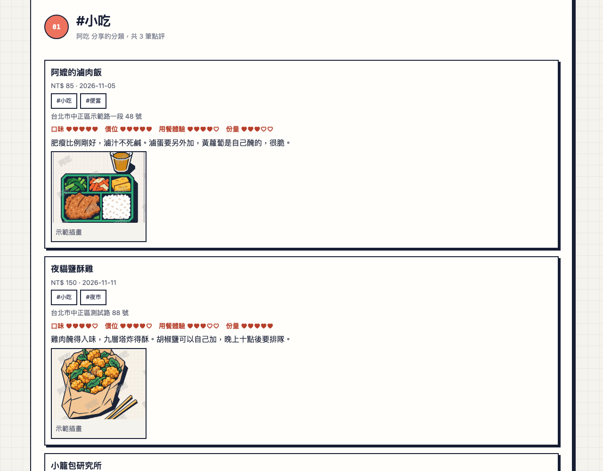
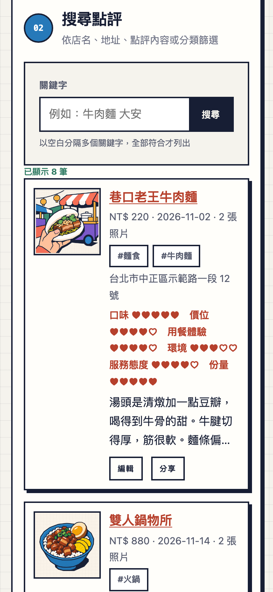
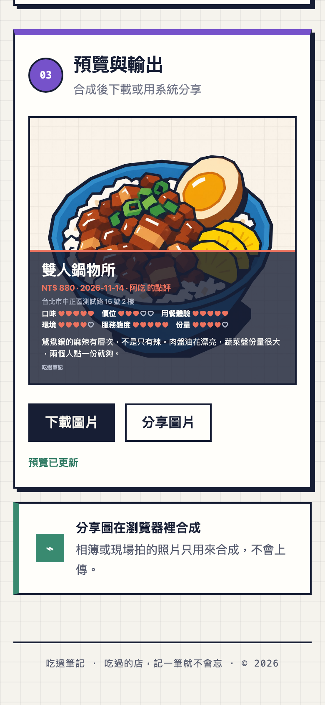

# 吃過筆記

[](https://deploy.workers.cloudflare.com/?url=https://github.com/lazyjerry/foods)

記錄餐廳、餐點、價格、點評、位置、評比與照片，並把點評做成浮水印分享圖。跑在 Cloudflare Workers，點評存 D1，壓縮後的照片存 R2。

- 線上網址：`https://food-review.<子網域>.workers.dev`（需要通行金鑰或帳號密碼）

## 畫面



分享操作：分享圖、建立分享網頁連結、開分享卡片複製網址，再從公開分享頁開分享卡片。


| 點評列表 | 新增／編輯（地圖選位置） |
|---|---|
|  |  |
| **照片集** | **公開分享頁（免登入）** |
|  |  |
| **手機：點評列表** | **手機：分享圖合成** |
|  |  |

畫面中的店家、地址與點評都是虛構的示範資料，照片是 AI 產生的插畫；還沒有照片的點評會顯示預設圖。重拍方式見「本機開發」。

## 功能

| 頁面 | 路徑 | 內容 |
|---|---|---|
| 點評列表 | `/` | 搜尋店名、餐點、地址、點評內容、分類，多個關鍵字以空白分隔；點分類標籤直接搜尋該分類 |
| 新增／編輯 | `/edit`、`/edit?id=…` | 必填：餐廳、價格、點評（0–2000 字）、座標；選填：餐點、地址（分享時空白顯示「我不知道地址」）、用餐日期、分類（標籤，最多 10 個）、評比、照片 |
| 照片集 | `/photos` | 瀏覽、搜尋（含分類）、下載壓縮後的照片 |
| 分享 | `/share?id=…`、`/share?tab=web` | 「分享圖」頁籤：勾選欄位做成浮水印，底圖可選點評照片、相簿、現場拍照或純文字，可下載或用系統分享；「分享網頁」頁籤：把整個分類或單一點評建成免登入的公開連結，可停止分享，或開分享卡片（網址加一張連結卡片圖） |
| 公開分享頁 | `/s/<token>` | 免登入、唯讀；每筆有「導航」（Google 地圖或裝置地圖，依座標），照片以 base64 內嵌，不露出照片網址；右上角「分享」可複製網址、下載或系統分享連結卡片圖 |
| 設定 | `/settings` | 稱呼、預設心數、新增時是否開啟評比、分享預設勾選欄位與浮水印位置、照片長邊與 JPEG 品質；通行金鑰管理、密碼登入開關、修改密碼；公開分享頁的 GA4 評估 ID |
| 統計 | `/stats`、`/stats?from=…&to=…` | 依日期範圍（以用餐日期為準）統計：總覽（筆數、花費、平均心數、各項評比平均、常用分類）、綜合或單項評比最好與最壞的 5 筆（附「修改」直達編輯頁）、兩項評比的 5×5 對照格、每日／週／月／年的用餐次數、花費與平均心數趨勢；每張統計附一句使用情境 |

- **地圖**：Leaflet + OpenStreetMap 圖磚。新增時預設定位到目前位置；點地圖或拖曳標記會自動查地址，輸入地址按「查座標」會移動標記。
- **地址互轉**：Worker 代理 OpenStreetMap Nominatim，快取 1 天。只在按鈕或移動標記後才查詢（Nominatim 每秒 1 次的限制）。
- **評比**：口味、價位、用餐體驗、環境、服務態度、份量，各 1–5 顆心，可略過；整組評比為選填。
- **照片**：拍照或從相簿選，在瀏覽器裡縮到長邊 1600px（可在設定改）並重新編碼成 JPEG 才上傳。
- **PWA**：可加入主畫面當 App 用。Service worker 只在離線時顯示離線頁，不快取點評、照片與 API，登出或換帳號後不會留下舊資料。公開分享頁不註冊。

## 隱私

- 原始照片不離開裝置；R2 只存壓縮後的 JPEG，重新編碼時移除 EXIF（含拍攝位置）。
- 分享圖在瀏覽器的 canvas 合成，相簿或現場拍的底圖不上傳。
- 全站需要登入。帳號與密碼存在 D1 的 `users` 表，密碼只存 PBKDF2-SHA256 加鹽雜湊，不存明文（ADR 018）。登入後發 HMAC 簽章的 HttpOnly cookie，30 天到期。
- 預設帳號是 `admin`。第一次登入用 Worker secret `APP_PASSWORD` 當密碼，登入成功後會改存成雜湊；之後在設定頁「帳號與密碼」修改，其他裝置的登入隨之失效。
- 也可以用通行金鑰（passkey，WebAuthn）登入：在設定頁新增後，登入頁會出現「用通行金鑰登入」。D1 只存公鑰；金鑰綁定網域，本機與正式環境各自註冊。
- 有通行金鑰後，可在設定頁關閉「允許密碼登入」，登入頁只剩通行金鑰；`APP_PASSWORD` 仍是 cookie 的簽章金鑰，不能刪（換掉它會讓所有登入失效）。
- 地址查詢會把地址或座標送到 OpenStreetMap Nominatim。
- 分享網頁的連結是隨機 token，猜不到但轉傳後任何人都能開；停止分享即刪除 token，連結立刻失效。刪除點評時它的分享連結一併刪除。

## 本機開發

需要 Node.js 與 Python 3（產生頁面與測試用；瀏覽器測試需要 Playwright）。

```sh
npm install
npm run vendor                 # 把 Leaflet 與 SimpleWebAuthn 複製到 public/vendor/
printf 'APP_PASSWORD=dev-password\n' > .dev.vars
npm run migrate:local
npm run dev                    # http://localhost:8787，帳號 admin、密碼 dev-password
```

通行金鑰要用 `http://localhost:8787` 開，`127.0.0.1` 這類 IP 不能當 RP ID。

測試：

```sh
bash scripts/check.sh                          # 重產頁面、Jerry UI 規則檢查、JS 語法
bash scripts/smoke-api.sh                      # API 冒煙測試（本機）
python3 scripts/e2e.py                         # 瀏覽器端到端測試（本機，含虛擬驗證器的通行金鑰流程）
bash scripts/smoke-api.sh <網址> <密碼> [帳號]  # 對正式環境跑，會建立並刪除一筆測試資料；不測修改密碼
python3 scripts/photo-gc-test.py               # 照片檔共用的併發與中斷情境（本機，需先跑 npx wrangler dev --test-scheduled）
```

重拍 README 的截圖與影片（需要 ffmpeg；地圖圖磚要連網）：

```sh
bash scripts/readme-media.sh [--seed N] [--share-only]
```

腳本在暫存目錄起一份全新的本機 D1／R2，不動 `.wrangler/` 與正式環境；寫入 `scripts/readme-media-reviews.json` 的虛構點評，從 `public/img/illustrations/` 隨機發插畫，輸出到 `docs/readme-media/`。要重現同一組照片分配，帶上次印出的 `--seed`；只重錄分享操作影片（`share.gif`）加 `--share-only`。

## 部署

### 一鍵部署

1. 按最上方的「Deploy to Cloudflare」按鈕（或開 `https://deploy.workers.cloudflare.com/?url=https://github.com/lazyjerry/foods`），登入 Cloudflare 帳號。
2. 連結 GitHub 或 GitLab 帳號。Cloudflare 會把這個 repo 複製一份到你的帳號，之後推送到複製出來的 repo 會自動重新部署。
3. 確認資源：D1 資料庫（binding `DB`）與 R2 bucket（binding `PHOTOS`）會在你的帳號新建，名稱可以改。
4. 填 `APP_PASSWORD`：它是登入密碼，也是登入 cookie 的簽章金鑰，請換成夠長的隨機字串（例如 `openssl rand -base64 24` 的輸出）。保留預設值 `change-me` 時 Worker 會拒絕所有登入。
5. 部署指令維持 `npm run deploy`：先用 binding 名 `DB` 套用 D1 migration，再部署 Worker。
6. 部署完成後開 Worker 網址（`https://<Worker 名稱>.<子網域>.workers.dev`），用帳號 `admin` 與剛填的 `APP_PASSWORD` 登入，再到設定頁改密碼、新增通行金鑰。

要在本機對自己的資源下 `wrangler` 指令（例如下方的救援指令）時，先確認複製出來的 `wrangler.jsonc` 裡 `database_id` 與 `database_name` 是你自己的 D1（`npx wrangler d1 list` 查得到），指令裡的 `food-review-db` 也換成你的資料庫名稱。用量卡的選填 secret 見下方「手動部署」。

### 手動部署

```sh
npx wrangler d1 create food-review-db          # 把 database_id 填進 wrangler.jsonc
npx wrangler r2 bucket create food-review-photos
npm run migrate:remote
npx wrangler deploy
npx wrangler secret put APP_PASSWORD
```

有新的 migration 時先 `npm run migrate:remote` 再 `npx wrangler deploy`，順序反過來新版會讀不到資料表。

設定頁的「用量」卡會顯示 D1、R2 已用空間。如果也要顯示今日 D1 讀寫列數與 Worker 請求數（帳號合計），另外設兩個 secret（選填，沒設就不顯示）：

```sh
npx wrangler secret put CF_ACCOUNT_ID        # 帳號 ID，npx wrangler whoami 查得到
npx wrangler secret put CF_ANALYTICS_TOKEN   # 在 Cloudflare 後台建立 API token，權限只給 Account Analytics:Read
```

關閉密碼登入後通行金鑰都不能用（換手機、金鑰被刪）時，用 wrangler 重新開啟密碼登入：

```sh
npx wrangler d1 execute food-review-db --remote --command "UPDATE auth_config SET password_login = 1"
```

忘記密碼時，清掉該帳號的密碼雜湊，再用 `APP_PASSWORD` 登入，登入後到設定頁改成新密碼：

```sh
npx wrangler d1 execute food-review-db --remote --command "UPDATE users SET password_hash = NULL, session_version = session_version + 1 WHERE username = 'admin'"
```

## 專案結構

```text
src/
  index.js        路由、登入檢查、照片上傳與下載
  auth.js         帳號密碼登入、修改密碼、cookie 簽章、通行金鑰的 challenge cookie
  password.js     密碼雜湊（PBKDF2-SHA256）與新密碼規則
  passkey.js      通行金鑰註冊、登入、刪除與密碼登入開關（SimpleWebAuthn）
  db.js           D1 查詢、欄位驗證、設定白名單（搜尋用 instr，避開 LIKE 的 50 bytes 限制）
  geo.js          Nominatim 代理與台灣地址格式
  http.js         回應與錯誤處理
migrations/       D1 schema
public/
  *.html          由 scripts/build_pages.py 產生，不要手改
  app.css         專案版面（只用 .app-* 與 Jerry UI token）
  jerry-ui.*      Jerry UI 元件庫固定檔，不要修改
  js/             各頁前端模組（common、list、edit、map、photo、photos、share、settings、stats、login）
  vendor/leaflet/ Leaflet 1.9.4（npm run vendor 產生）
  vendor/simplewebauthn/ SimpleWebAuthn 瀏覽器端 UMD（npm run vendor 產生）
  manifest.webmanifest、sw.js、js/pwa.js  PWA 設定、service worker 與註冊
  icons/、favicon.ico                     App icon（scripts/build_icons.py 產生）
scripts/
  build_pages.py  用 jerry-ui.py snippet 組頁面
  vendor.sh       複製 Leaflet 與 SimpleWebAuthn
  check.sh        靜態檢查
  check_illustrations.py  插畫檔名只增不改不刪的檢查（規則見 AGENTS.md）
  smoke-api.sh    API 冒煙測試
  e2e.py          Playwright 端到端測試
  photo-gc-test.py  照片檔共用的鎖與回收情境測試
  build_icons.py  產生 icon 與 favicon（需 macOS 內建中文字型；改設計時才重跑）
  readme-media.sh、readme_media.py、readme-media-reviews.json  重拍 README 截圖與影片
public/img/       點評沒有照片時的預設圖（no-photo-1～5.svg，依點評 id 分配）
  illustrations/  AI 產生的食物插畫：編輯頁「選擇插畫」與 README 錄製共用
docs/readme-media/
  screenshots/、demo.gif、share.gif  README 用的截圖與操作動畫
```

頁面外觀來自 Jerry UI 元件庫：改頁面結構請改 `scripts/build_pages.py` 再執行 `npm run pages`。Leaflet 的樣式表由 `public/js/map.js` 動態載入，這是 Jerry UI「不載入其他樣式表」規則的已知例外。
